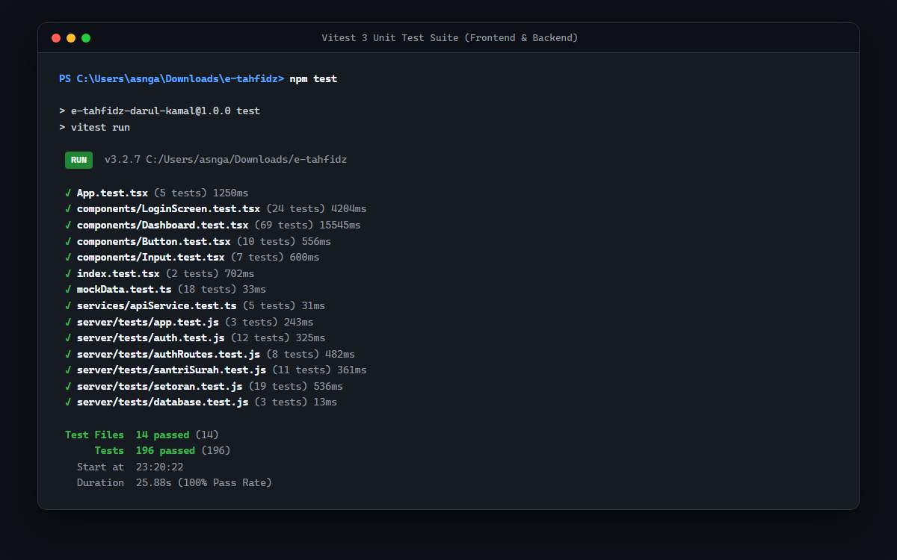
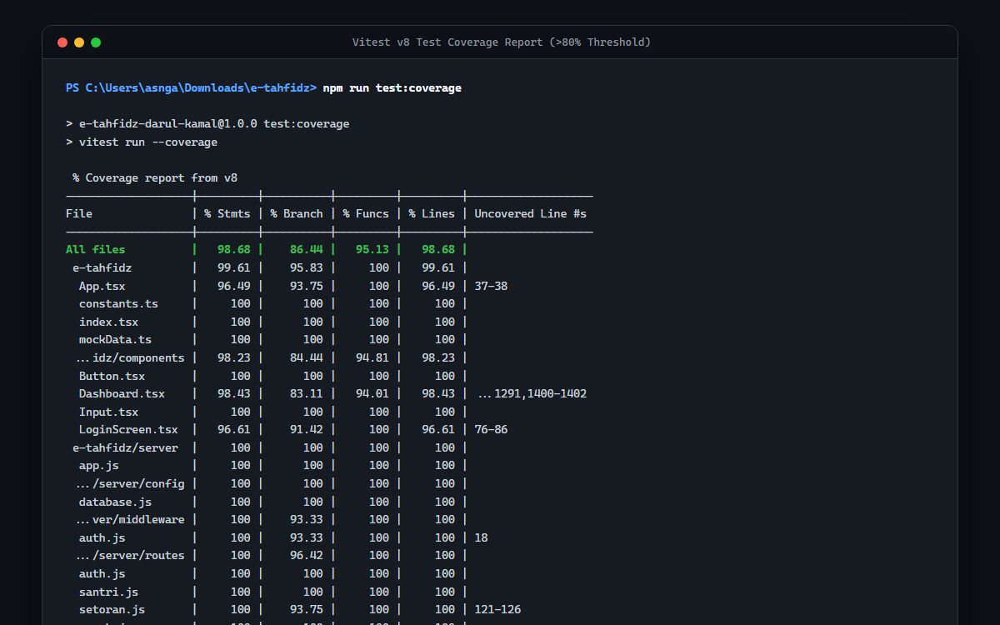

# 🧪 01. Unit Testing & Code Coverage Report

## 📋 Ringkasan Kriteria
- **Status Kriteria**: **Wajib** (Unit Test) & **Opsional** (Code Coverage $\ge 80\%$)
- **Framework Utama**: **Vitest 3**
- **Library Pengujian Frontend**: React Testing Library (`@testing-library/react`, `@testing-library/jest-dom`)
- **Library Pengujian Backend**: Supertest (`supertest`), In-Memory SQLite (`better-sqlite3`)
- **Total Test Files**: **14 Berkas Uji**
- **Total Tests Passed**: **196 Tests Passed (100% Pass Rate)**
- **Durasi Eksekusi**: $\approx 25$ detik
- **Rata-rata Coverage**: **98.68% Lines** (Standar: $\ge 80\%$)

---

## 📸 Tangkapan Layar Eksekusi Unit Test

### 1. Bukti Eksekusi Seluruh Unit Test (196 Passed)


### 2. Bukti Laporan Coverage v8 (>80% Threshold)


---

## 📊 Rincian Cakupan Kode (Code Coverage Table)

Data cakupan kode dihasilkan melalui mesin pelacak **v8** via perintah `npm run test:coverage`:

| Berkas / Direktori | % Statements | % Branch | % Functions | % Lines | Status ($\ge 80\%$) |
|---|:---:|:---:|:---:|:---:|:---:|
| **Semua Berkas (Total Rata-rata)** | **98.68%** | **86.44%** | **95.13%** | **98.68%** | 🟢 **MELEBIHI TARGET** |
| `App.tsx` | 96.49% | 93.75% | 100.00% | 96.49% | 🟢 LULUS |
| `constants.ts` | 100.00% | 100.00% | 100.00% | 100.00% | 🟢 LULUS |
| `index.tsx` | 100.00% | 100.00% | 100.00% | 100.00% | 🟢 LULUS |
| `mockData.ts` | 100.00% | 100.00% | 100.00% | 100.00% | 🟢 LULUS |
| `components/Button.tsx` | 100.00% | 100.00% | 100.00% | 100.00% | 🟢 LULUS |
| `components/Dashboard.tsx` | 98.43% | 83.11% | 94.01% | 98.43% | 🟢 LULUS |
| `components/Input.tsx` | 100.00% | 100.00% | 100.00% | 100.00% | 🟢 LULUS |
| `components/LoginScreen.tsx` | 96.61% | 91.42% | 100.00% | 96.61% | 🟢 LULUS |
| `services/apiService.ts` | 100.00% | 100.00% | 100.00% | 100.00% | 🟢 LULUS |
| `server/app.js` | 100.00% | 100.00% | 100.00% | 100.00% | 🟢 LULUS |
| `server/config/database.js` | 100.00% | 100.00% | 100.00% | 100.00% | 🟢 LULUS |
| `server/middleware/auth.js` | 100.00% | 93.33% | 100.00% | 100.00% | 🟢 LULUS |
| `server/routes/auth.js` | 100.00% | 100.00% | 100.00% | 100.00% | 🟢 LULUS |
| `server/routes/santri.js` | 100.00% | 100.00% | 100.00% | 100.00% | 🟢 LULUS |
| `server/routes/setoran.js` | 100.00% | 93.75% | 100.00% | 100.00% | 🟢 LULUS |
| `server/routes/surah.js` | 100.00% | 100.00% | 100.00% | 100.00% | 🟢 LULUS |

---

## 🗂️ Daftar 14 Berkas Uji (Test Suites)

### A. Pengujian Frontend (React UI & Interaksi State)
1. **`App.test.tsx` (5 tests)**:
   - Pengujian siklus hidup autentikasi aplikasi (render login form saat unauthenticated).
   - Pengujian alur masuk cepat (Quick Login) dan pengembalian state saat keluar akun (logout).
   - Pengujian persistensi URL backend Google Apps Script di localStorage.
2. **`components/LoginScreen.test.tsx` (24 tests)**:
   - Validasi formulir login saat field kosong.
   - Autentikasi demo untuk role Administrator (`admin`), Ustadz (`ustadz`), dan Santri (`12345`).
   - Penanganan error login ketika password salah.
   - Drawer konfigurasi Google Apps Script dan modal petunjuk integrasi.
3. **`components/Dashboard.test.tsx` (69 tests)**:
   - Navigasi antar-tab: Beranda, Jurnal Belajar, Rencana Setoran, Peta 30 Juz, Data Santri, Catatan Nilai, Pengaturan.
   - Pembedaan hak akses UI antara Administrator, Ustadz/Musyrif, dan Santri.
   - Fitur Jurnal Belajar Mandiri (tambah jurnal, simpan, validasi).
   - Fitur Rencana Setoran (pengajuan jadwal hafalan).
   - Fitur Peta 30 Juz (tampilan grid, tabel, evaluasi status juz, filter status).
   - Fitur Penanda Terakhir Baca (Bookmark modal & simpan).
   - Fitur Ekspor Data Santri ke format CSV.
   - Pengaturan API backend dan penanganan uji koneksi.
4. **`components/Button.test.tsx` (10 tests)**:
   - Pengujian varian warna tombol (primary, secondary, danger, success, outline).
   - Pengujian status loading dan disabled button.
5. **`components/Input.test.tsx` (7 tests)**:
   - Pengujian input text, label rendering, helper text, error text, dan class merging.
6. **`index.test.tsx` (2 tests)**:
   - Pengujian entry point mount elemen `#root` React DOM.
7. **`mockData.test.ts` (18 tests)**:
   - Pengujian integritas data bawaan (daftar 114 surat Al-Qur'an, metadata 30 juz, inisialisasi default juz progress).
8. **`services/apiService.test.ts` (5 tests)**:
   - Pengujian integrasi fetch API ke Google Apps Script backend (`callAPI`).

### B. Pengujian Backend (Express.js REST API & Database)
9. **`server/tests/app.test.js` (3 tests)**:
   - Pengujian inisialisasi Express server, middleware CORS, parser JSON, dan penonaktifan header `X-Powered-By`.
10. **`server/tests/auth.test.js` (12 tests)**:
    - Pengujian middleware JWT token verifier, penolakan token kadaluwarsa, dan pembatasan peran `requireRole(['admin'])`.
11. **`server/tests/authRoutes.test.js` (8 tests)**:
    - Pengujian endpoint `POST /api/auth/login` untuk admin dan santri, verifikasi bcrypt password hash.
12. **`server/tests/santriSurah.test.js` (11 tests)**:
    - Pengujian endpoint `GET /api/santri` dan `GET /api/surah` (daftar surat Al-Qur'an dan pagination).
13. **`server/tests/setoran.test.js` (19 tests)**:
    - Pengujian endpoint `POST /api/setoran`, kalkulasi otomatis total hafalan santri saat ziyadah, validasi field wajib, dan error handling database.
14. **`server/tests/database.test.js` (3 tests)**:
    - Pengujian koneksi SQLite in-memory, pembuatan tabel, dan foreign key constraints.

---

## 💻 Cara Menjalankan Unit Test

```powershell
# Menjalankan seluruh pengujian unit
npm test

# Menjalankan pengujian dengan pemantauan perubahan (watch mode)
npm run test:watch

# Menjalankan pengujian disertai tabel cakupan kode (coverage)
npm run test:coverage
```
