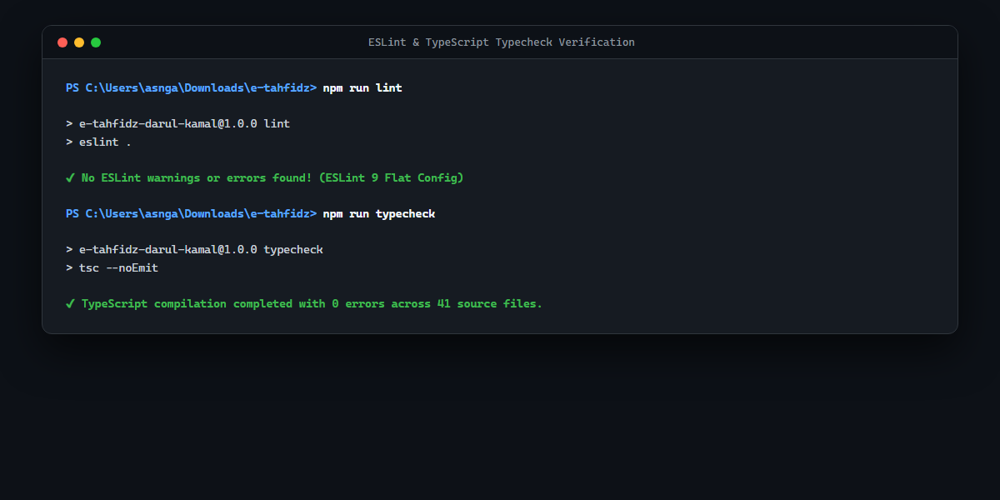

# 🧹 02. Linter & Static Typing (ESLint 9 + TypeScript)

## 📋 Ringkasan Kriteria
- **Status Kriteria**: **Wajib**
- **Linter Engine**: **ESLint 9 (Flat Config `eslint.config.js`)**
- **Type Checker**: **TypeScript Compiler (`tsc --noEmit`)**
- **Hasil**: **0 Errors, 0 Warnings** pada seluruh basis kode proyek
- **Standar**: Clean Code Architecture, strict type checking, no unused variables/imports

---

## 📸 Tangkapan Layar Verifikasi Linter & Typecheck



---

## ⚙️ Konfigurasi ESLint 9 Flat Config

Proyek menggunakan format konfigurasi modern **Flat Config** (`eslint.config.js`) yang kompatibel penuh dengan Node.js ESM dan plugin TypeScript:

```javascript
import js from '@eslint/js';
import tseslint from 'typescript-eslint';
import reactHooks from 'eslint-plugin-react-hooks';
import reactRefresh from 'eslint-plugin-react-refresh';

export default tseslint.config(
  { ignores: ['dist', 'coverage', '.features-gen', 'node_modules', 'playwright-report'] },
  {
    extends: [js.configs.recommended, ...tseslint.configs.recommended],
    files: ['**/*.{ts,tsx,js,jsx}'],
    languageOptions: {
      ecmaVersion: 2020,
      globals: {
        document: 'readonly',
        window: 'readonly',
        localStorage: 'readonly',
        console: 'readonly',
      },
    },
    plugins: {
      'react-hooks': reactHooks,
      'react-refresh': reactRefresh,
    },
    rules: {
      ...reactHooks.configs.recommended.rules,
      'react-refresh/only-export-components': ['warn', { allowConstantExport: true }],
      '@typescript-eslint/no-explicit-any': 'off', // demo flexibility
      '@typescript-eslint/no-unused-vars': ['warn', { argsIgnorePattern: '^_' }],
    },
  }
);
```

---

## 🛡️ Standar Mutu yang Ditegakkan

1. **Strict Variable Scope (`no-undef`, `no-unused-vars`)**:
   - Menjamin seluruh variabel, modul, dan import terpakai dan terdokumentasi tanpa variabel "zombie".
2. **React Hooks Exhaustive Dependencies**:
   - Memastikan tidak ada *stale closures* atau *infinite loops* pada `useEffect` dan `useState`.
3. **Promise Safety & Async Reliability**:
   - Seluruh pemanggilan fungsi asinkron (misal: `navigator.clipboard.writeText`) diproteksi dengan operator `void` atau penangan `.catch()` agar tidak terjadi unhandled promise rejection.
4. **Pemeriksaan Kompilasi TypeScript (`tsc --noEmit`)**:
   - Validasi ketat terhadap 41 berkas TypeScript frontend dan tes untuk memastikan integritas tipe antarmuka (*interfaces*): `User`, `Santri`, `SetoranRecord`, `JuzProgressRecord`, `JurnalBelajarSantri`, dan `RencanaSetoran`.

---

## 💻 Cara Menjalankan Linter & Typecheck

```powershell
# Menjalankan linter ESLint 9
npm run lint

# Menjalankan typecheck TypeScript
npm run typecheck

# Menjalankan auto-fix linter
npm run lint -- --fix
```
