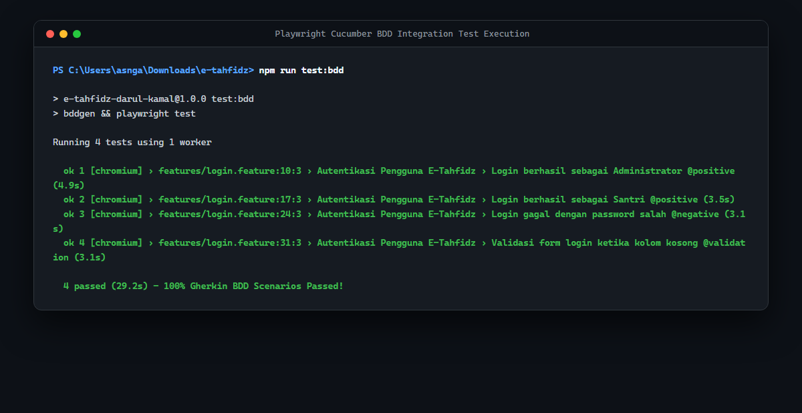
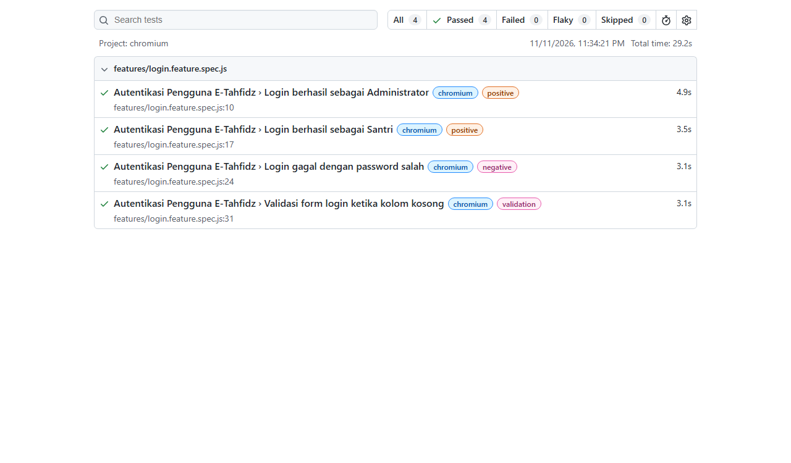

# 🎭 03. Integration Testing (Playwright + Cucumber BDD)

## 📋 Ringkasan Kriteria
- **Status Kriteria**: **Opsional**
- **Framework BDD**: **Playwright + Cucumber (`playwright-bdd`)**
- **Bahasa Skenario**: **Gherkin dalam Bahasa Indonesia**
- **Total Skenario Uji**: **4 Skenario**
- **Hasil**: **4/4 Passed (100% Pass Rate)**
- **Browser yang Diuji**: Chromium (Headless & Headed Mode)

---

## 📸 Tangkapan Layar Eksekusi Integration Testing

### 1. Bukti Eksekusi Terminal BDD (4/4 Passed)


### 2. Bukti Laporan Interaktif Playwright HTML Report


---

## 📝 Naskah Fitur & Skenario BDD (`features/login.feature`)

Pengujian integrasi ditulis dalam format *Behavior-Driven Development (BDD)* berbasis naskah Gherkin:

```gherkin
# language: id
Fitur: Autentikasi Pengguna E-Tahfidz
  Sebagai pengguna aplikasi E-Tahfidz Pondok Pesantren Darul Kamal
  Saya ingin dapat masuk ke dalam sistem dengan akun yang sesuai
  Agar saya dapat mengakses fitur pencatatan hafalan Al-Qur'an

  @positive @admin
  Skenario: Login berhasil sebagai Administrator
    Dengan pengguna berada di halaman login
    Ketika pengguna mengisi username "admin" dan password "admin123"
    Dan pengguna menekan tombol masuk
    Maka pengguna berhasil masuk ke dashboard

  @positive @santri
  Skenario: Login berhasil sebagai Santri
    Dengan pengguna berada di halaman login
    Ketika pengguna mengisi username "12345" dan password "santri123"
    Dan pengguna menekan tombol masuk
    Maka pengguna berhasil masuk ke dashboard

  @negative
  Skenario: Login gagal dengan password salah
    Dengan pengguna berada di halaman login
    Ketika pengguna mengisi username "admin" dan password "password_salah"
    Dan pengguna menekan tombol masuk
    Maka sistem menampilkan pesan kesalahan login

  @validation
  Skenario: Validasi form login ketika kolom kosong
    Dengan pengguna berada di halaman login
    Ketika pengguna mengosongkan username dan password
    Dan pengguna menekan tombol masuk
    Maka sistem menampilkan pesan kesalahan login
```

---

## 🛠️ Implementasi Step Definitions (`steps/login.steps.ts`)

Langkah-langkah pengujian dihubungkan dengan elemen antarmuka browser menggunakan atribut `data-testid` untuk memastikan keandalan selector:

```typescript
import { expect } from '@playwright/test';
import { createBdd } from 'playwright-bdd';

const { Given, When, Then } = createBdd();

Given('pengguna berada di halaman login', async ({ page }) => {
  // Membersihkan localStorage sebelum navigasi untuk menjamin isolasi state antar pengujian
  await page.addInitScript(() => {
    try { localStorage.clear(); } catch {}
  });
  await page.goto('/');
  await expect(page.getByTestId('login-form')).toBeVisible();
});

When('pengguna mengisi username {string} dan password {string}', async ({ page }, username: string, pass: string) => {
  await page.getByTestId('username').fill(username);
  await page.getByTestId('password').fill(pass);
});

When('pengguna mengosongkan username dan password', async ({ page }) => {
  await page.getByTestId('username').fill('');
  await page.getByTestId('password').fill('');
});

When('pengguna menekan tombol masuk', async ({ page }) => {
  await page.getByTestId('login-button').click();
});

Then('pengguna berhasil masuk ke dashboard', async ({ page }) => {
  await expect(page.getByTestId('dashboard')).toBeVisible();
});

Then('sistem menampilkan pesan kesalahan login', async ({ page }) => {
  await expect(page.getByTestId('login-error')).toBeVisible();
});
```

---

## 🛡️ Penanganan Masalah Lingkungan Uji

1. **Test State Leak & Isolasi**:
   - Menambahkan `page.addInitScript(() => localStorage.clear())` pada langkah *Given* untuk mencegah sesi login tersimpan antar skenario.
2. **Defensive Proxy Cleanup (`playwright.config.ts`)**:
   - Membersihkan variabel lingkungan proxy Windows yang tidak valid secara dinamis saat runner Playwright dijalankan.
3. **Web Server Otomatis**:
   - Runner Playwright secara otomatis menjalankan dev server Vite (`npm run dev`) pada port `5173` jika server belum aktif.

---

## 💻 Cara Menjalankan Integration Test BDD

```powershell
# Menjalankan BDD test mode headless
npm run test:bdd

# Menjalankan BDD test mode headed (tampilan browser terlihat nyata untuk demo presentasi)
npm run test:bdd:headed

# Membuka laporan HTML Playwright interaktif
npx playwright show-report
```
