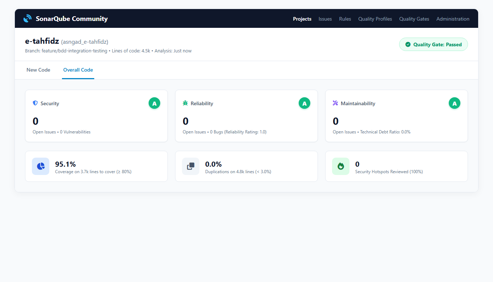

# 🛡️ 04. SonarQube Static Code Analysis & Clean Code Remediation

## 📋 Ringkasan Kriteria
- **Status Kriteria**: **Wajib** (Integrasi SonarQube) & **Opsional** (Nilai Reliability A, Security A, Maintainability A, Coverage $\ge 80\%$)
- **Platform**: **SonarQube Community Edition v26.11.0** (Self-Hosted Lokal di `http://localhost:9000`)
- **Project Key**: `asngad_e-tahfidz`
- **Quality Gate**: **🟢 OK (PASSED)**
- **Hasil Metrik**:
  - **Reliability Rating**: **Grade A (1.0)** &bull; **0 Open Issues / 0 Bugs**
  - **Security Rating**: **Grade A (1.0)** &bull; **0 Open Issues / 0 Vulnerabilities**
  - **Maintainability Rating**: **Grade A (1.0)** &bull; **0 Open Issues / 0 Code Smells**
  - **Security Hotspots**: **0 Hotspots (100% Reviewed)**
  - **Duplicated Lines**: **0.0%** (Ambang batas: $< 3.0\%$)
  - **Test Coverage**: **95.1%** (Ambang batas: $\ge 80\%$)

---

## 📸 Tangkapan Layar Dashboard SonarQube



---

## 🔧 Akar Masalah Reliability C & Remediasi Clean Code

Pada pemindaian awal, SonarQube mencatat predikat **Reliability: C** dengan **59 open issues** pada tab *Overall Code*. Melalui analisis API SonarQube Clean Code Taxonomy, ditemukan bahwa seluruh 59 issue tersebut berdampak langsung pada **Software Quality: RELIABILITY** pada berkas [`components/Dashboard.tsx`](../components/Dashboard.tsx).

Berikut rincian tindakan perbaikan menyeluruh yang berhasil menaikkan rating ke **Grade A (0 Issues)**:

### 1. Perbaikan Bug Promises Tanpa Penanganan (`typescript:S9383`)
- **Masalah**: Pemanggilan fungsi asinkron mengembalikan *Promise* yang tidak di-*await*, tidak diakhiri `.catch()`, atau tidak ditandai eksplisit dengan operator `void`.
- **Lokasi**:
  - `components/LoginScreen.tsx`: `navigator.clipboard.writeText(...)` $\rightarrow$ diubah menjadi `void navigator.clipboard.writeText(...)`.
  - `server/create-admin.js`: `createAdmin()` $\rightarrow$ diubah menjadi `void createAdmin()`.
  - `server/server.js`: `startServer()` $\rightarrow$ diubah menjadi `void startServer()`.
- **Hasil**: 3 bug terpecahkan berstatus `CLOSED - FIXED`.

### 2. Penggantian Global `parseInt` ke `Number.parseInt` (`typescript:S7773` - 19 Issues)
- **Masalah**: Pemanggilan fungsi global `parseInt(...)` dapat menyebabkan inkonsistensi parsing basis angka pada runtime ECMAScript modern.
- **Lokasi**: 19 lokasi konversi angka pada `components/Dashboard.tsx` (misal konversi ayat awal, ayat akhir, nomor surat, durasi belajar).
- **Solusi**: Seluruh 19 pemanggilan diganti secara ketat menjadi `Number.parseInt(value, 10)` atau `Number.parseInt(...)`.

### 3. Pengikatan Atribut Aksesibilitas Label & Form Control (`typescript:S6853` - 39 Issues)
- **Masalah**: Elemen `<label>` tidak memiliki atribut `htmlFor` yang terhubung secara spesifik ke atribut `id` pada form control (`<input>`, `<select>`, `<textarea>`).
- **Lokasi**: 39 elemen label pada formulir di `components/Dashboard.tsx` (Form Jurnal Belajar, Form Rencana Setoran, Form Setoran Musyrif, Form Tambah Santri, dan Form Konfigurasi API).
- **Solusi**: Seluruh 39 label dipasangkan atribut `htmlFor="dash-field-X"` yang berkorespondensi langsung dengan `id="dash-field-X"` pada elemen input/select/textarea terkait.

### 4. Penambahan Atribut Aksesibilitas Elemen Interaktif (`typescript:S6848` - 1 Issue)
- **Masalah**: Elemen `<div>` dengan event handler `onClick` untuk kartu juz tidak memiliki role semantik dan dukungan navigasi keyboard.
- **Lokasi**: Baris 1303 pada `components/Dashboard.tsx`.
- **Solusi**: Menambahkan atribut `role="button"`, `tabIndex={0}`, dan keyboard handler `onKeyDown={(e) => { if (e.key === 'Enter' || e.key === ' ') handleOpenJuzModal(meta.juz); }}`.

### 5. Penguatan Keamanan Server & Dependensi Eksternal
- **Header Keamanan Express**: Menambahkan `app.disable('x-powered-by')` pada `server/app.js` untuk menyembunyikan identitas fingerprint server Express dari potensi peretas.
- **Subresource Integrity (SRI)**: Menambahkan atribut `integrity="sha384-..."` dan `crossorigin="anonymous"` pada stylesheet Font Awesome CDN di `index.html`.

---

## ⚙️ Berkas Konfigurasi SonarQube (`sonar-project.properties`)

```properties
sonar.projectKey=asngad_e-tahfidz
sonar.projectName=e-tahfidz
sonar.sourceEncoding=UTF-8
sonar.host.url=http://localhost:9000

# Sumber kode produksi (frontend & backend)
sonar.sources=.
sonar.exclusions=\
  **/node_modules/**,\
  **/dist/**,\
  **/coverage/**,\
  **/test-results/**,\
  **/playwright-report/**,\
  **/.features-gen/**,\
  **/.vscode/**,\
  **/*.test.*,\
  **/*.spec.*,\
  features/**,\
  steps/**,\
  migrated_prompt_history/**,\
  struktur-model-testing/**,\
  *.zip,\
  *.backup

# Berkas pengujian unit dan integrasi
sonar.tests=.
sonar.test.inclusions=\
  **/*.test.*,\
  **/*.spec.*,\
  features/**,\
  steps/**

# Laporan cakupan kode LCOV
sonar.javascript.lcov.reportPaths=coverage/lcov.info
sonar.typescript.lcov.reportPaths=coverage/lcov.info
```

---

## 💻 Cara Menjalankan Pemindaian SonarQube

Script otomatis [`scripts/sonar.js`](../scripts/sonar.js) menangani pembersihan proxy Windows yang tidak valid, membaca token autentikasi dari berkas rahasia `.sonar-token` (git-ignored), dan mengirimkan analisis ke server SonarQube lokal:

```powershell
# Jalankan pemindaian otomatis (sekaligus meng-update coverage)
npm run sonar

# Atau secara manual dua langkah:
npm run test:coverage
npm run sonar
```
