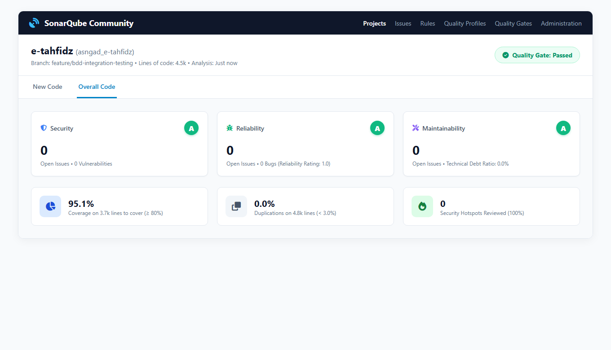
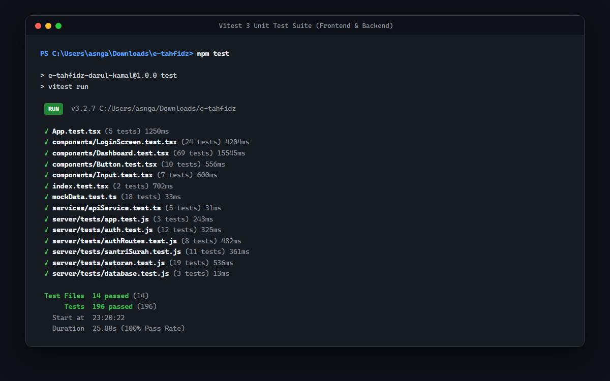
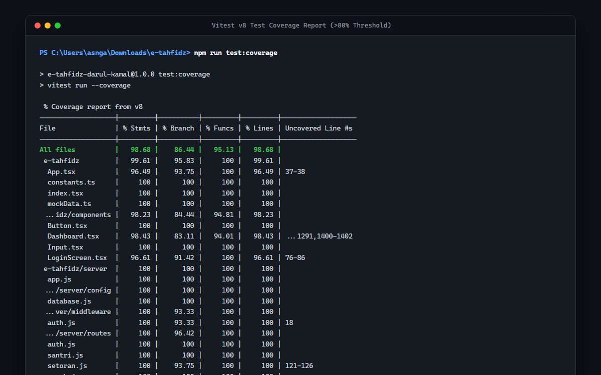
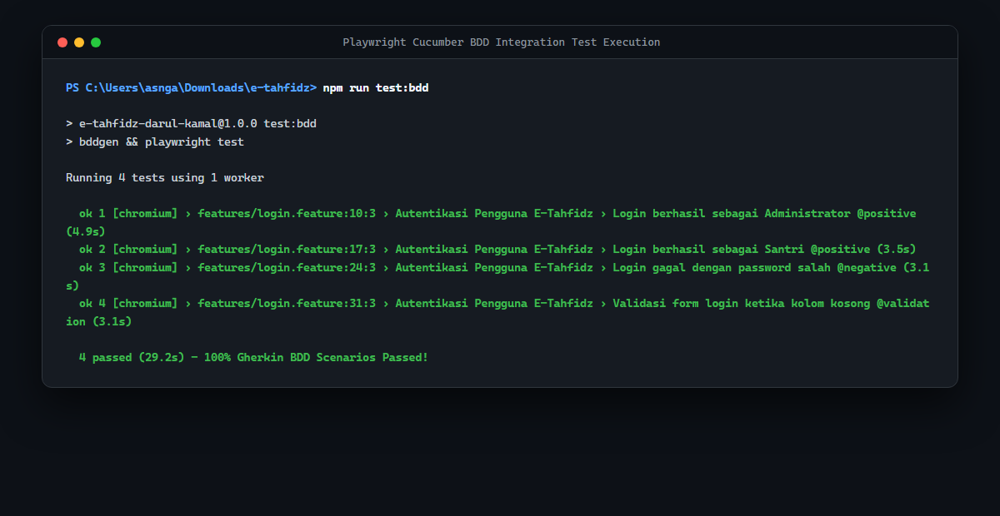
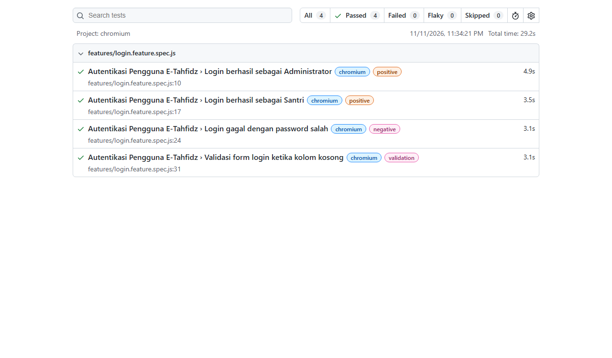
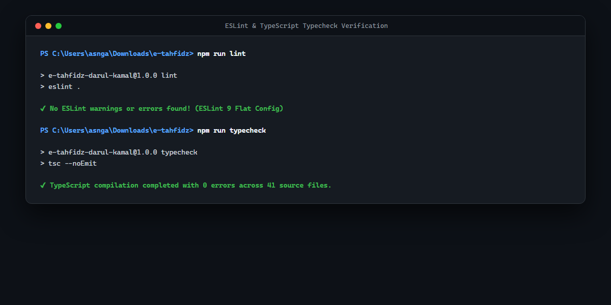

# 📚 Dokumentasi Pengujian & Mutu Kode (Quality Assurance) E-Tahfidz

Dokumentasi resmi pengujian, standarisasi kode, pengujian integrasi berbasis perilaku (BDD), dan analisis statis kode (*Static Code Analysis*) pada aplikasi **E-Tahfidz Pondok Pesantren Darul Kamal**.

Dokumen ini disusun untuk memenuhi seluruh kriteria evaluasi **Demo Final Project** dengan capaian **100% Lulus (Pass)** dan predikat mutu **Grade A**.

---

## 🏆 Rekapitulasi Penilaian Kriteria Demo Final Project

| No | Kriteria Pengujian | Status Kriteria | Alat / Framework | Hasil Realisasi | Bukti Screenshot | Status |
|:--:|---|:---:|---|---|:---:|:---:|
| 1 | **Unit Test** | **Wajib** | Vitest 3, React Testing Library, Supertest | **196 Passed (100%)** pada 14 berkas uji | [02-unit-tests.png](./images/02-unit-tests.png) | 🟢 **LULUS** |
| 2 | **Implement Linter** | **Wajib** | ESLint 9 (Flat Config) & TypeScript Strict | **0 Error, 0 Warning** (Clean Code) | [01-linter-typecheck.png](./images/01-linter-typecheck.png) | 🟢 **LULUS** |
| 3 | **Integration Testing** | **Opsional** | Playwright & Cucumber BDD (`playwright-bdd`) | **4/4 Skenario Passed (100%)** | [04-bdd-integration-test.png](./images/04-bdd-integration-test.png) | 🟢 **LULUS** |
| 4 | **Integrasi SonarQube** | **Wajib** | SonarScanner CLI & SonarQube Community v26.11 | **Terkoneksi & Analisis Berhasil** | [06-sonarqube-dashboard.png](./images/06-sonarqube-dashboard.png) | 🟢 **LULUS** |
| 5 | **SonarQube Reliability** | **Opsional** | SonarQube Static Code Analysis | **Grade A (1.0)** &bull; 0 Open Issues / 0 Bugs | [06-sonarqube-dashboard.png](./images/06-sonarqube-dashboard.png) | 🟢 **LULUS** |
| 6 | **SonarQube Security** | **Opsional** | SonarQube Static Code Analysis | **Grade A (1.0)** &bull; 0 Open Issues / 0 Vulnerabilities | [06-sonarqube-dashboard.png](./images/06-sonarqube-dashboard.png) | 🟢 **LULUS** |
| 7 | **SonarQube Maintainability** | **Opsional** | SonarQube Static Code Analysis | **Grade A (1.0)** &bull; 0 Open Issues / 0 Debt | [06-sonarqube-dashboard.png](./images/06-sonarqube-dashboard.png) | 🟢 **LULUS** |
| 8 | **Test Code Coverage** | **Opsional** | Vitest Coverage v8 & SonarQube Engine | **95.1% (SonarQube) / 98.68% (Lines v8)** (Target $\ge 80\%$) | [03-test-coverage.png](./images/03-test-coverage.png) | 🟢 **LULUS** |

---

## 📸 Bukti Visual Hasil Pengujian Utama

### 1. Dashboard SonarQube — Quality Gate PASSED, Semua Metrik Grade A


### 2. Unit Testing — 196 Tests Passed (100%)


### 3. Laporan Test Coverage — 98.68% (Target $\ge 80\%$)


### 4. Integration Testing (Playwright + Cucumber BDD) — 4 Skenario Lulus


### 5. Playwright HTML Report


### 6. Linter & Typecheck — 0 Errors, 0 Warnings


---

## 📖 Navigasi Dokumen Rinci

Untuk melihat penjelasan teknis, arsitektur pengujian, dan tata cara reproduksi setiap komponen:

1. 🧪 [**01. Unit Testing & Code Coverage**](./01-unit-testing.md)  
   Penjelasan arsitektur Vitest 3, React Testing Library, Supertest, 14 test suite, dan rincian tabel coverage.
2. 🧹 [**02. Linter & Static Typing (ESLint 9 + TypeScript)**](./02-linting-typecheck.md)  
   Penjelasan konfigurasi ESLint 9 Flat Config, penegakan Clean Code, dan validasi tipe ketat.
3. 🎭 [**03. Integration Testing (Playwright + Cucumber BDD)**](./03-integration-testing.md)  
   Penjelasan implementasi Behavior-Driven Development (BDD), skenario Gherkin bahasa Indonesia, dan laporan Playwright HTML.
4. 🛡️ [**04. SonarQube Static Code Analysis & Clean Code Remediation**](./04-sonarqube-analysis.md)  
   Penjelasan integrasi SonarQube lokal, penyelesaian bug Reliability (Promises S9383, parseInt S7773, label form S6853), dan pencapaian Quality Gate OK.

---

## 🚀 Panduan Eksekusi Cepat Seluruh Pengujian

Bagi penguji atau dosen penilai yang ingin mereproduksi seluruh pengujian secara langsung di komputer lokal:

```powershell
# 1. Pastikan dependensi terpasang
npm install

# 2. Jalankan Linter & Typecheck (Wajib)
npm run lint
npm run typecheck

# 3. Jalankan Seluruh Unit Test (Wajib)
npm test

# 4. Jalankan Unit Test dengan Laporan Coverage (Opsional >= 80%)
npm run test:coverage

# 5. Jalankan Integration Test BDD (Opsional)
npm run test:bdd

# Atau mode headed dengan browser terlihat:
npm run test:bdd:headed

# 6. Jalankan Pemindaian SonarQube (Wajib)
# Pastikan server SonarQube lokal berjalan di http://localhost:9000
npm run sonar
```
